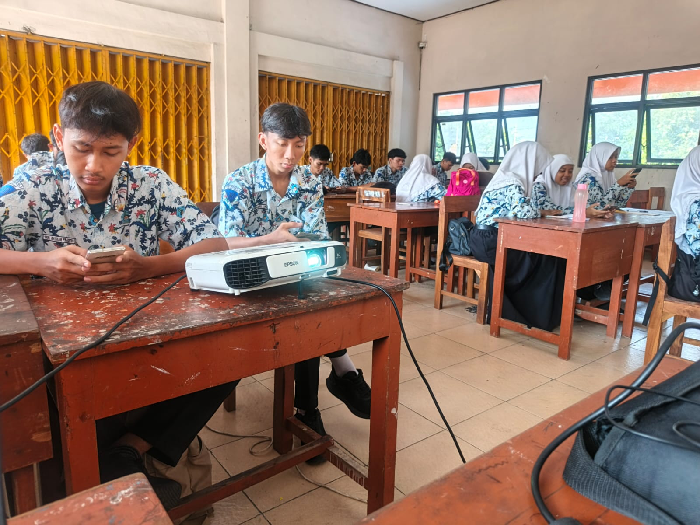

# Siswa Kelas XII TJKT

## Mata Pelajaran

- **Mapel:** Videografis

## Bidang Keahlian

- Konfigurasi Jaringan & Routing (MikroTik & Cisco)
- Administrasi Sistem Operasi Server (Linux Debian & Ubuntu)
- Instalasi & Terminasi Kabel Jaringan (UTP & Fiber Optic)
- Keselamatan dan Kesehatan Kerja (K3) Bidang Telekomunikasi

## Formulir Memngumpulkan Tugas Umpan Balik / Absensi
Buatlah Simulasi Digital dalam bentuk videografis Animasi dan Letakkan di Repository Github. 
Kumpulkan Link pembuatan , di alamat berikut : 

- [Isi Google Formulir di Sini](https://forms.gle/1CqPbMfq3i5ishYg6)
